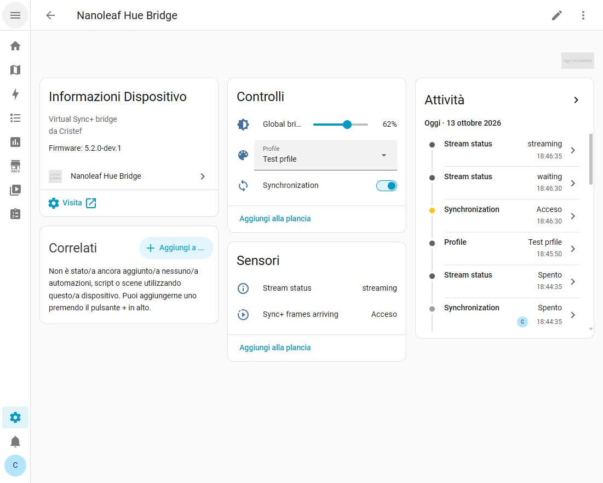
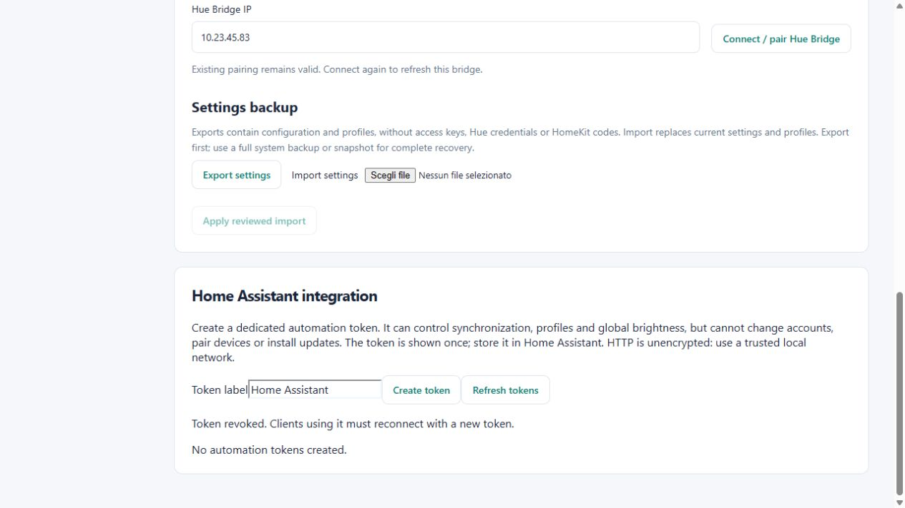

# Nanoleaf Hue Bridge for Home Assistant

Control [Nanoleaf Hue Bridge](https://github.com/Cristef/nanoleaf-hue-bridge) from Home Assistant. This integration adds synchronization, brightness and profile controls, along with sensors for the stream status and incoming Sync+ frames.

The bridge continues running on Debian. Home Assistant connects to its local API, so you can add dashboard controls and automations while the bridge handles the color stream.

## Requirements

- Home Assistant 2025.12 or newer.
- Nanoleaf Hue Bridge 4.2.0 or newer.
- Network access from Home Assistant to the bridge on HTTP port 80 or 8080.

The integration has been tested on Home Assistant OS. Install the standalone bridge first if you have not already set it up.

## Install with HACS

1. Open HACS and add `https://github.com/Cristef/nanoleaf-hue-bridge-ha` as a **custom repository**, with **Integration** as the category.
2. Download the integration and restart Home Assistant.
3. Go to **Settings → Devices & services → Add integration** and search for **Nanoleaf Hue Bridge**.

For manual installation, copy `custom_components/nanoleaf_hue_bridge` into Home Assistant's `/config/custom_components/` directory and restart.

## Connect the bridge

Open the bridge portal and go to **Setup → Home Assistant integration**. Create a token and copy it into the Home Assistant setup form, together with the bridge URL.

Use `http://nanoleaf-hue.local` or `http://BRIDGE_IP:8080`. The IP address is usually the simpler option when Home Assistant and the bridge are on different VLANs. Make sure your firewall allows the connection.

The token is displayed only when you create it. You can revoke it from the portal and create a replacement when needed. Home Assistant supports reauthentication, and **Reconfigure** lets you change the bridge address.

## Controls and sensors

| Entity | Function |
| --- | --- |
| Synchronization | Enables or disables the virtual receiver. |
| Global brightness | Sets output brightness from 0–100%, keeping individual light levels. |
| Profile | Applies a profile saved in the bridge portal. |
| Stream status | Reports Off, Waiting, Streaming, Error or Unavailable. |
| Sync+ frames arriving | Indicates whether recent color frames are reaching the bridge. |

For example, an automation can enable synchronization when the TV turns on, apply a Cinema profile, or reduce brightness in the evening. Your existing Hue integration remains available for normal light control.

State updates every five seconds. Commands update the controls immediately. Turning synchronization off releases Hue Entertainment; the bulbs remain on with their last color.

## Diagnostics

In Home Assistant, open the bridge device and choose **Download diagnostics** from its menu. The report includes connection status, stream freshness and light/panel counts, without the bridge URL, access token or profile names.

## Local API

The integration uses a dedicated token rather than your portal password or Hue credentials. Its access is limited to state, synchronization, profiles and global brightness.

Communication uses HTTP on the local network. Keep the bridge on a trusted LAN and do not expose its ports to the Internet. Local discovery and downloadable diagnostics are included. Discovery requires a bridge version that advertises its service, and normally works within the same LAN. Manual setup remains available across VLANs. Hosting the bridge as a Home Assistant app/add-on is not currently included.

For the API details, see the bridge's [automation API documentation](https://github.com/Cristef/nanoleaf-hue-bridge/blob/main/docs/AUTOMATION_API.md).

## License

This Home Assistant integration is available under the [MIT License](LICENSE), including commercial use. The separate [Nanoleaf Hue Bridge](https://github.com/Cristef/nanoleaf-hue-bridge) project retains its PolyForm Noncommercial license.

This is a community integration, unaffiliated with Nanoleaf, Philips Hue or Home Assistant.
